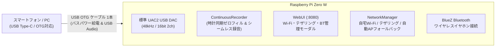
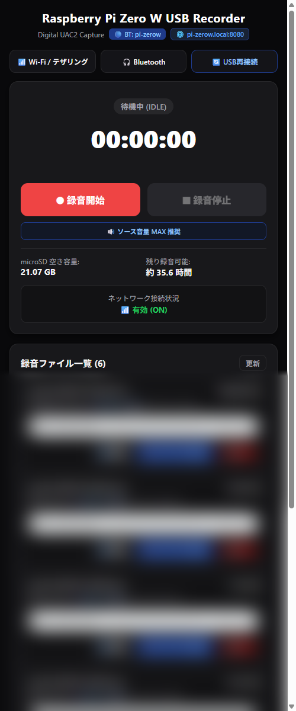

# PI UAC2 Recorder (Pi-ZeroW USB Audio Recorder)

Raspberry Pi Zero W をスマートフォン等のホスト機器と USB OTG ケーブル 1 本で接続し、バスパワー給電を受けながら、高品質なデジタル音声録音（USB Audio Class 2.0）とスマートフォンから操作可能な高機能 Web 管理インターフェースを提供するポータブルレコーダーシステムです。



---

## 📱 WebUI インターフェース

スマートフォンの片手操作に最適化されたダークテーマのレスポンシブ WebUI です。

<div align="center">
  
</div>

- **1タップ録音 & 正確な実時間タイマー同期**
- **「⬇️ 原音」ストリーミング保存 ＆ 「🔊 ラウドネス保存」（進捗バー付き・音割れ防止ソフトリミッター）**
- **Wi-Fi / テザリング設定モーダル & Bluetooth イヤホン接続管理**
- **ケーブル抜き差し不要の「🔄 USB再接続」機能**

---

## ✨ 主な特長

1. **USB ケーブル 1 本で完結（バスパワー給電）**:
   - スマホと Pi Zero W の内側（USB）ポートを OTG ケーブル 1 本で接続するだけで、スマホから安定給電（約 120mA）され、外部電源やバッテリー不要で動作。
2. **標準 UAC2 準拠の汎用デジタルキャプチャ**:
   - USB Audio Class 2.0 (48kHz / 16bit 2ch) の標準仕様を採用。Android（Galaxy, Xperia, Xiaomi 等）、iPhone（15以降 Type-Cモデル）、iPad、PC 等、主要な Type-C ホスト機器でドライバー不要のプラグ＆プレイに対応（※Google Pixel シリーズはハードウェア・OS固有の制約によりサポート対象外。詳細は [SETUP_GUIDE.md](SETUP_GUIDE.md#5-️-google-pixel-シリーズをサポート対象外としている理由) を参照）。
3. **ContinuousRecorder（無音待機・シームレス再結合）**:
   - 動画の一時停止やアプリ切り替え、待機状態でも録音プロセスがクラッシュせず、実時間時計と同期した無音ゼロフィルを自動挿入。再生再開時には自動で PCM データに切り替わり、音ズレのない 1 つの完全な WAV ファイルを生成。
4. **ブラウザ側ラウドネスノーマライズ ＆ リアルタイム進捗表示**:
   - WebUI 上で RMS エネルギー測定と適応型ソフトリミッター（tanh サチュレーション圧縮）による音割れ防止ラウドネス調整（目標 -18.2 dBFS）を実行可能。
   - ストリーミング受信進捗（％ ＆ 受信済みMB / 総MB）とボタン背景プログレスゲージにより、進行状況を一目で把握可能。
5. **ハイブリッド自動フォールバック・ネットワーク**:
   - **自宅**: 自宅 Wi-Fi（優先度 100）に自動接続。
   - **外出先テザリング**: 登録済みのスマホテザリング（優先度 80）を検知して最優先接続。
   - **完全オフライン**: 既知の Wi-Fi がない場合、自動的に AP 親機（`Pi-Recorder-Hotspot` / WPA2 `recorder1234` / IP `192.168.4.1`）として立ち上がり、スマホから直接接続して Web 操作可能。
6. **Bluetooth イヤホン連携（製品名自動解決、保存機器即時再接続＆解除、リアルタイム再生）**:
   - WebUI から周囲のワイヤレスイヤホンをスキャン・接続し、スマホ等の音声をリアルタイムでモニタリング可能。
   - ペアリング情報は自動保存され、次回以降はスキャン待ちなしでワンタップ即時再接続が可能。不要な機器はWebUIからワンタップでペアリング解除できます。
7. **極限の省電力＆ブート最適化**:
   - HDMI オフ、LED 完全消灯、不要サービス（cloud-init 等）のマスクにより、起動時間を大幅短縮し消費電流を最小化。

---

## ⚡ Raspberry Pi Zero W シリーズ限定の理由と給電仕様

本システムは、**Raspberry Pi Zero W / Zero 2 W のみを公式サポート**しています。一般的な大型モデル（Raspberry Pi 3B / 4B / 5 等）に対応せず、Zero W シリーズに特化している理由および USB 給電電流の仕様は以下の通りです。

### 1. Zero W シリーズに限定している技術的理由

1. **DWC2 USB コントローラの直接配線（ネイティブ OTG / ガジェット機能）**:
   - 通常の Raspberry Pi（3B / 4B / 5 等）は、SoC と USB ポートの間に USB ハブチップやイーサネットコントローラ（LAN9514 / VL805 等）が接続されており、標準の USB ポートを「スマホや PC から認識されるオーディオデバイス（スレーブ / ガジェット）」として動作させることが物理的に困難または不可能です。
   - 一方、Zero W / Zero 2 W は SoC（BCM2835 等）の DWC2 USB コントローラが microUSB 端子（内側 USB ポート）に直接配線されているため、完全な USB Audio Class 2.0 ガジェットとして安定して列挙・通信できます。
2. **スマートフォンの給電能力に適合する「超低消費電力」**:
   - Raspberry Pi 4 や 5 は通常動作時に 1.5A 〜 3.0A 以上の大電流を必要とし、スマートフォンの USB ポートからのバスパワーでは電力不足（電圧降下・過電流遮断）により起動すらできません。
   - Zero W は待機時〜録音時でも **約 100mA 〜 140mA (0.5W〜0.7W)** と極めて省電力であり、スマートフォンの給電規格（500mA〜1500mA）の安全圏内で余裕を持って連続稼働できます。
3. **完全バッテリーレス・手のひらサイズのポータブル運用**:
   - 外部モバイルバッテリーや分岐ケーブルを一切持たず、スマホとケーブル 1 本で繋ぐだけで手のひらに収まる録音機が完成します。

### 2. USB から提供される電流と消費電流の比較

スマートフォンの USB Type-C ポートから供給可能な電流と、本システムの実測消費電流の比較です。

| 項目 | 電流値 (5V) | 電力 (W) | 備考 |
| :--- | :--- | :--- | :--- |
| **スマホ供給能力 (USB 2.0 規格枠)** | **500 mA** | 2.5 W | 最低保証規格枠 |
| **スマホ供給能力 (Type-C / 3.x 規格枠)** | **900 mA 〜 1,500 mA** | 4.5 W 〜 7.5 W | 一般的な Type-C スマホの給電上限 |
| **本機: 待機時 (アイドル / WebUI表示)** | **約 100 mA 〜 110 mA** | **約 0.5 W** | 省電力チューニング適用済 |
| **本機: 録音中 (UAC2 キャプチャ + 保存)** | **約 120 mA 〜 140 mA** | **約 0.6 W 〜 0.7 W** | microSD への連続書き込み中 |
| **本機: 最大ピーク時 (Wi-Fi 高速通信時)** | **約 160 mA 〜 200 mA** | **約 0.8 W 〜 1.0 W** | 音声ファイル一括ダウンロード時 |

> [!TIP]
> **スマートフォンのバッテリーへの影響**:
> 本システムの最大消費電流（約 200mA）は、スマートフォンの最低給電能力（500mA）の **40% 以下**、一般的な Type-C 給電枠（1,500mA）の **わずか 13% 程度** です。スマホのバッテリーに過度な負荷をかけることなく、発熱や電圧ドロップによる給電遮断の心配なく安全にお使いいただけます。

---

## 📚 ドキュメント一覧 (Documentation)

プロジェクトの詳細情報・マニュアルは、以下の各ドキュメントをご参照ください。

| ドキュメント | 内容 |
| :--- | :--- |
| 📖 **[セットアップ手順書 (SETUP_GUIDE.md)](SETUP_GUIDE.md)** | 初期 PiOS からの全自動一括インストール手順、設定検証（ヘルスチェック全9項目） |
| 📱 **[利用手順書・操作マニュアル (USER_GUIDE.md)](USER_GUIDE.md)** | WebUI の使い方、録音・保存・テザリング登録・Bluetooth 連携・PWA アプリ化 |

---

## 🚀 クイックスタート

### 1. 初回セットアップ（Windows PC から 1 コマンド）
Raspberry Pi OS Lite を書き込んだ Pi Zero W がネットワークに繋がった状態で、PC の PowerShell から実行します。

```powershell
powershell -ExecutionPolicy Bypass -File setup_to_pi.ps1 -ip 192.168.1.186
```
> ※ 詳細は [セットアップ手順書 (SETUP_GUIDE.md)](SETUP_GUIDE.md) を参照してください。

### 2. 設定完了・稼働状態の確認（ヘルスチェック）
```powershell
powershell -ExecutionPolicy Bypass -File verify_pi_setup.ps1 -ip 192.168.1.186
```

### 3. WebUI へのアクセス
- 自宅 Wi-Fi: `http://pi-zerow.local:8080/`
- 外出先 AP: Wi-Fi `Pi-Recorder-Hotspot` に接続後、`http://192.168.4.1:8080/`

---

## 📁 ディレクトリ構成

```text
PI UAC2 Recorder/
├── README.md               # プロジェクト概要・目次
├── SETUP_GUIDE.md          # 【公開】一括セットアップ手順書 & 検証マニュアル
├── USER_GUIDE.md           # 【公開】WebUI 利用手順書・操作マニュアル
├── webui_main.png          # 【公開】WebUI 実機スクリーンショット画像
├── setup_to_pi.ps1         # PC からの一括全自動インストーラー
├── verify_pi_setup.ps1     # PC からの設定完了検証チェッカー
├── src/                    # ソースコード
│   ├── setup-usb-gadget.sh # 標準 UAC2 USB Audio ガジェット構築スクリプト
│   ├── recorder_web.py     # 録音制御、ContinuousRecorder、REST API サーバー
│   └── check_power_settings.py # ハードウェア・省電力診断ツール
├── html/                   # フロントエンド & PWA アセット
│   ├── index.html          # モバイル操作用 WebUI
│   ├── manifest.json       # PWA マニフェスト設定
│   └── *.png               # アプリ・ファビコン用各種アイコン
├── scripts/                # プロビジョニング & 運用スクリプト
│   ├── setup_all.sh        # Pi 上で実行する一括セットアップスクリプト
│   ├── verify_setup.sh     # Pi 上で実行する全9項目ヘルスチェックスクリプト
│   └── setup_power_save.sh # 省電力設定スクリプト
└── doc/                    # 内部開発・監査ドキュメント（非公開）
    ├── architecture.md     # システムアーキテクチャ設計書
    └── reviewer_report.md  # 品質・セキュリティ検証報告書
```
