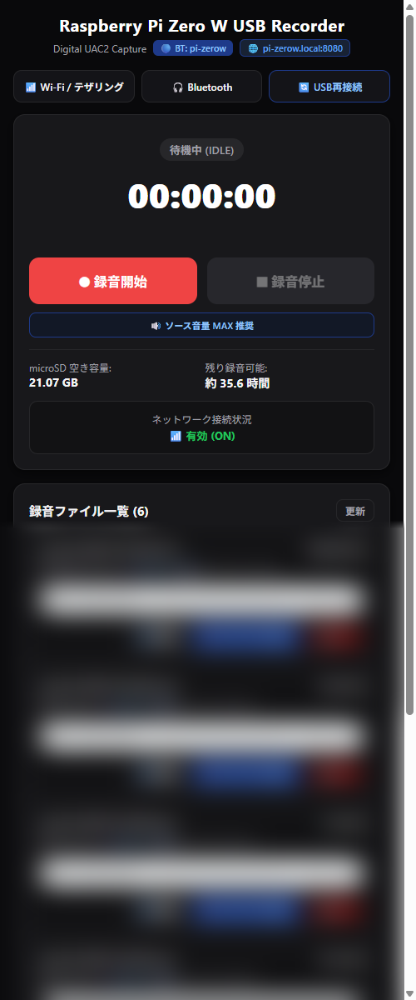

# PI UAC2 Recorder 利用手順書・操作マニュアル (USER_GUIDE.md)

本ドキュメントでは、スマートフォンまたは PC から WebUI を操作して録音、ファイル管理、Wi-Fi・Bluetooth 設定を行う手順を解説します。

---

## 1. WebUI へのアクセス方法

Raspberry Pi Zero W とスマートフォンを USB OTG ケーブル 1 本で接続すると、自動的に給電が開始され、約 30〜40 秒でシステムが立ち上がります。

### ① 自宅 Wi-Fi に接続している場合
スマホが自宅 Wi-Fi に繋がっている場合、ブラウザから以下のアドレスにアクセスします。
- `http://pi-zerow.local:8080/` または `http://<Raspberry PiのIP>:8080/`

### ② 外出先・オフライン環境の場合（自動 AP モード）
自宅 Wi-Fi がない環境では、Pi が自動的にアクセスポイント親機として立ち上がります。
1. スマートフォンの Wi-Fi 設定を開き、**`Pi-Recorder-Hotspot`** に接続します。
   - **パスワード**: `recorder1234`
2. ブラウザを開き、以下のアドレスにアクセスします。
   - **`http://192.168.4.1:8080/`**

---

## 2. WebUI 画面構成

スマートフォンの片手操作に最適化されたダークテーマのレスポンシブ UI です。

### 画面各部の役割
1. **ヘッダー**:
   - 接続中の Bluetooth 機器名、アクセス中の FQDN / ポートを表示。
2. **クイックツールバー**:
   - `[📶 Wi-Fi / テザリング]`: テザリング親機の追加・Wi-Fi スキャン
   - `[🎧 Bluetooth]`: ワイヤレスイヤホンの検索・接続・切断
   - `[🔄 USB再接続]`: ケーブルを抜き差しせずに USB を強制再認識
3. **メイン録音カード**:
   - ステータスバッジ（待機中 IDLE / 録音中 REC）
   - 録音タイマー（実時間と 1 対 1 で同期）
   - `[● 録音開始]` / `[■ 録音停止]` ボタン
   - 「🔊 ソース音量 MAX 推奨」ガイド
   - microSD 空き容量（GB）および残り録音可能時間（約 -- 時間）
   - ネットワーク接続状態（有効 ON / 停止中 OFF）
4. **録音ファイル一覧**:
   - ファイル名、容量（MB）、録音時間、サンプリング周波数（48.0 kHz 等）、更新日時
   - インライン再生プレーヤー
   - `[⬇️ 原音]`: ストリーミング一括ダウンロード
   - `[🔊 ラウドネス保存]`: リアルタイム進捗バー付き音量最適化ダウンロード
   - `[🗑️ 削除]`: 確認モーダル付きファイル削除

---

## 3. 基本的な録音操作

### ステップ 1: スマートフォンの音量を最大にする
- USB 経由で最高のダイナミックレンジ（高音質）で録音するため、スマートフォンのメディア音量を **MAX（100%）** に設定してください。

### ステップ 2: 録音を開始する
- `[● 録音開始]` をタップします。
- タイマーがカウントを開始し、ステータスが「録音中 (REC)」に切り替わります。
- **スマホの時計とミリ秒精度で同期**し、WAV ファイル名（例: `audio_20261104_104454.wav`）が自動決定されます。

> [!NOTE]
> **無音待機（ゼロフィル）機能**:
> 動画を一時停止したりアプリを切り替えて無音になっても、録音プロセスは停止せず、正確な無音データ（0埋め）が挿入されます。再生が再開されると自動的にシームレス結合されます。

### ステップ 3: 録音を停止する
- `[■ 録音停止]` をタップします。
- 録音データが microSD に安全にフラッシュされ、ファイル一覧の一番上に即座に追加されます。

---

## 4. 音声ファイルの再生と保存

### ① ブラウザ上での試聴
- ファイルカード内の再生プレーヤーで、録音した音声をその場ですぐに試聴できます。

### ② 「⬇️ 原音」での保存
- 録音された 48kHz / 16bit 2ch の無加工 WAV データをそのままダウンロードします。
- ブラウザネイティブの保存機能を使用するため、ギガバイト級の大容量ファイルでも安定して保存できます。

### ③ 「🔊 ラウドネス保存」（推奨）
- 小さな音量で録音された音声を、放送・配信標準ラウドネス（目標 -18.2 dBFS）に合わせて自動増幅し、適応型ソフトリミッター（tanh圧縮）で音割れを防いでダウンロードします。
- **ストリーミング進捗可視化**:
  - ボタン背景ゲージが青く満たされ、テキストに進捗率（％）と容量（例: `⏳ 45% (80.5/175.2MB)`）がリアルタイムに表示されます。
- **暗騒音ガード**:
  - 完全無音や微小ノイズのファイルは自動で等倍出力（1.0x）に分岐し、サー音の爆音化を防ぎます。

---

## 5. ネットワーク & Bluetooth 管理

### 📶 スマホ・テザリングの登録
1. クイックバーの `[📶 Wi-Fi / テザリング]` をタップします。
2. 「📱 スマホ・テザリングを追加」で、お使いのスマホのテザリング SSID とパスワードを入力し、優先度 80 で「登録して接続」を押します。
3. 次回以降、テザリングを有効にすると Pi が自動接続します。

### 🎧 Bluetooth イヤホンの接続（リアルタイムモニター）
1. クイックバーの `[🎧 Bluetooth]` をタップします。
2. **保存済み機器からの再接続**:
   - 過去に接続した機器は「💾 ペアリング済み機器」に自動保存されており、スキャン待ち時間なしで横の「接続」をタップするだけで即座に再接続できます。
3. **不要な機器のペアリング削除（解除）**:
   - 「💾 ペアリング済み機器」内の各機器右側にある `[🗑️]`（ゴミ箱）ボタンをタップすると、Pi 内からペアリング情報を安全に完全削除できます。
4. **新しいイヤホンの追加**:
   - お手持ちのワイヤレスイヤホンをペアリング待機状態（ケースのボタン長押し等）にします。
   - 「スキャン開始」を押すと、周囲のイヤホンが 🎧 アイコン付きで最上位に一覧表示されます。
   - 目的のイヤホン横の「接続」をタップすると、スマホの再生音がイヤホンからリアルタイムに流れます（接続時に自動でペアリング情報も保存されます）。

### 🔄 USB 再接続（ソフト抜き差し）
- スマホが USB 音声出力を認識しなくなった場合、クイックバーの `[🔄 USB再接続]` を押すことで、給電を維持したまま通信線のみをソフト的に切断・再バインド（強制再エニュメレーション）できます。

---

## 6. PWA（ホーム画面追加）によるアプリ化

スマートフォンのブラウザ（Chrome / Safari）のメニューから **「ホーム画面に追加」** を選択すると、専用のアプリアイコンがホーム画面に作成されます。
ホーム画面から起動するとアドレスバーが消え、ネイティブアプリ同様の全画面で快適に操作できます。

---

## 7. 取り外しと電源オフ

本システムは、microSD への安全なフラッシュ書き込みと、WAV ヘッダーの自動自己修復機能を搭載しています。
特別なシャットダウン操作は不要で、**録音停止中であればいつでも USB ケーブルを抜いて給電を切って問題ありません**。
